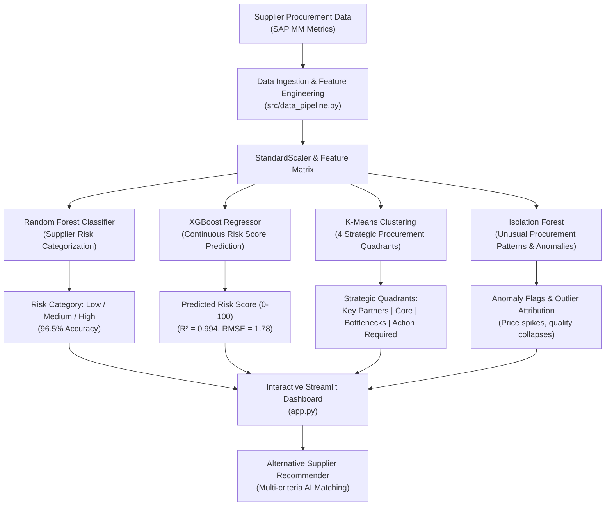

# Supplier Risk Intelligence & Procurement Analytics System

> SAP MM (Materials Management) | Supplier Relationship Management (SRM) | Source-to-Pay (S2P) | Predictive Procurement Analytics

An enterprise-grade Supplier Risk Intelligence platform designed to evaluate supplier performance, predict supply disruptions, identify single-source concentration vulnerabilities, detect anomalous procurement patterns, and recommend qualified alternative vendors.

---

## 🏢 Business Problem & Procurement Context

Modern procurement and supply chain departments face critical challenges:
1. **Unreliable Suppliers:** Delivery delays and quality rejections directly stall production lines and inflate inventory buffer costs.
2. **Supplier Concentration Risk:** Over-reliance on single-source suppliers in volatile regions exposes companies to catastrophic disruption.
3. **Delayed Risk Detection:** Traditional supplier evaluations (e.g., quarterly reviews) are backward-looking and fail to predict impending failure.
4. **Lack of Actionable Mitigation:** When a vendor fails, procurement teams scramble to locate pre-qualified backup suppliers with comparable capacity and terms.

This solution integrates **SAP MM Master Data & Purchasing History** with **Machine Learning** to automate supplier evaluation, predict disruption severity, flag operational anomalies, and recommend alternative sourcing partners.

---

## 🎯 SAP MM Alignment & Technical Relevance

| SAP MM Concept / Process | SAP Tables / T-Codes | Project Feature / Implementation |
| :--- | :--- | :--- |
| **Vendor / Supplier Master** | `LFA1` (General), `LFB1` (Company Code), `LFM1` (Purchasing Org), S/4HANA `BUT000` | Supplier ID, name, location, country, payment terms, purchasing organization |
| **Purchasing Documents** | `EKKO` (PO Header), `EKPO` (PO Item), `EKBE` (PO History) | PO volume, net spend (USD), planned delivery lead times, contract compliance |
| **Goods Receipt & Delivery** | `EKET` (PO Delivery Schedule), `MSEG` / `MATDOC` | Delivery delay days, On-Time delivery rate, In-Full delivery rate, OTIF % |
| **Quality Management** | `QALS` (Inspection Lot), `QMEL` (Quality Notifications) | Incoming inspection defect rate %, goods receipt rejections |
| **Supplier Evaluation** | `ME61` / `ME64` (Vendor Evaluation Scorecards) | Multi-criteria weighted composite risk scoring (Delivery, Quality, Price, Solvency) |
| **Source Determination** | `ME01` (Source List), `ME11` (Purchasing Info Record) | AI Alternative Supplier Recommendation Engine for qualified backup sourcing |
| **Concentration Risk** | `EORD` / Single-Source Flag | Herfindahl-Hirschman single-source dependency index across Material Groups (`MATKL`) |

---

## 📊 CSV File Structure & Schema Specification

You can feed your own CSV file into the pipeline or use the built-in simulated SAP MM dataset. Below is the required file structure:

### Required & Recommended Columns

| Column Name | Data Type | Required? | SAP MM Mapping | Description & Guidance | Example Value |
| :--- | :--- | :---: | :--- | :--- | :--- |
| `Supplier_ID` | String | **Yes** | `LFA1-LIFNR` / `BUT000` | Unique Vendor Account Number | `VEND-10024` |
| `Supplier_Name` | String | **Yes** | `LFA1-NAME1` | Supplier Name | `Apex Components Corp` |
| `Country` | String | **Yes** | `LFA1-LAND1` | Sourcing Country | `Germany` |
| `City` | String | **Yes** | `LFA1-ORT01` | Supplier Operating City | `Stuttgart` |
| `Material_Group` | String | **Yes** | `EKPO-MATKL` | Commodity / Material Group category | `Electronics & Sensors` |
| `Purchasing_Org` | String | Optional | `LFM1-EKORG` | SAP Purchasing Organization code | `1000` |
| `Payment_Terms` | String | Optional | `LFM1-ZTERM` | Payment terms key | `NT30` |
| `PO_Count` | Integer | **Yes** | `COUNT(EKKO-EBELN)` | Total Purchase Orders executed | `142` |
| `Total_Spend_USD` | Float | **Yes** | `SUM(EKPO-NETWR)` | Total annual procurement net spend in USD | `1850000.00` |
| `On_Time_Delivery_Rate`| Float | **Yes** | `ME61` / `EKET` | % deliveries on/before committed date (0-100) | `94.5` |
| `In_Full_Delivery_Rate` | Float | **Yes** | `ME61` / `EKBE` | % deliveries meeting 100% PO quantity (0-100) | `96.0` |
| `OTIF_Rate` | Float | Optional | Calculated / `ME61` | Combined On-Time In-Full delivery % (0-100) | `90.72` |
| `Defect_Rate_Pct` | Float | **Yes** | `QALS` / `QMEL` | Incoming quality rejection / defect % (0-100) | `1.25` |
| `Average_Delay_Days` | Float | **Yes** | `EKBE-BUDAT` - `EKET-EINDT` | Average late delivery duration in days | `1.8` |
| `Lead_Time_Days` | Float / Int | **Yes** | `EKPO-PLIFZ` | Planned / actual delivery cycle in days | `28` |
| `Price_Variance_Pct` | Float | **Yes** | `RSEG-WRBTR` vs `EKPO-NETPR`| Invoiced price vs PO standard price variance % | `0.8` |
| `Financial_Stability_Score` | Float | **Yes** | Credit / D&B Rating | Solvency / Financial health index (1-100, 100=best)| `82.0` |
| `Geopolitical_Risk_Score` | Float | **Yes** | Country Risk Index | Regional supply disruption index (1-100, 100=highest risk)| `15.0` |
| `Single_Source_Flag` | Integer | **Yes** | `ME01` / Sole Sourcing | Binary indicator (1 if sole vendor for material group)| `0` |
| `Contract_Compliance_Rate`| Float | Optional | `EKKO-KONNR` | % POs referencing master outline agreement | `95.0` |
| `ESG_Score` | Float | Optional | ESG Rating | Sustainability & Governance rating (1-100) | `88.0` |

> *Note: If `OTIF_Rate` is omitted in your CSV, the pipeline automatically computes it as `(On_Time_Delivery_Rate * In_Full_Delivery_Rate) / 100`.*

---

## 🤖 Machine Learning Architecture



### 1. Random Forest Classifier
- **Objective:** Classifies suppliers into discrete operational risk tiers: **Low Risk**, **Medium Risk**, and **High Risk**.
- **Performance:** **96.50% Accuracy** (Macro F1: 0.9588).
- **Key Insight:** Feature importance reveals that incoming quality defect rate and delivery delay are the two strongest predictors of supplier operational failure.

### 2. XGBoost Regressor
- **Objective:** Predicts a continuous, granular **Composite Risk Score (0 - 100)** to measure exact risk severity.
- **Performance:** **R² = 0.9941** | **RMSE = 1.78** | **MAE = 1.11**.

### 3. K-Means Supplier Segmentation
- **Objective:** Unsupervised segmentation of the supplier base into 4 strategic procurement quadrants:
  1. **Strategic Key Partners:** High Spend, OTIF > 90%, Defect < 1.0%, Risk < 15.
  2. **Operational Core Performers:** Moderate Spend, Stable OTIF (75-85%), Low/Medium Risk.
  3. **Underperforming / Action Plan:** Low OTIF (65-75%), Elevated Defects, Moderate Risk.
  4. **Critical Risk & Bottleneck:** High Lead Times, Severe Delays, Defect Rate > 8%, High Risk.

### 4. Isolation Forest Anomaly Detector
- **Objective:** Detects subtle, irregular procurement patterns such as sudden invoice price spikes (+25%), extreme quality dropoffs, or high spend with near-insolvent vendors.
- **Result:** Detects the top ~4.5% anomalous operational patterns for targeted procurement audit.

### 5. Alternative Supplier Recommender
- **Objective:** When a vendor is flagged as high-risk, the algorithm automatically searches the supplier pool within the same **Material Group (`MATKL`)**, filtering for high OTIF (>88%), low defect rate (<3%), and optimal solvency.
- **Output:** Top 3-5 ranked alternative suppliers with exact expected gains (`+OTIF gain %`, `-Defect reduction %`, `-Risk drop`, and geographic diversification bonus).

---

## 🚀 Quickstart: Train the Model & Run the Project

### 1. Prerequisites
Ensure you have Python 3.10+ installed. Install the required libraries:
```bash
pip install -r requirements.txt
```

### 2. Run the End-to-End Pipeline (Train Models)
Run the automated pipeline to generate data, prepare features, and train all 4 ML models:
```bash
# Uses the built-in realistic SAP MM simulated dataset (1,000 records)
python run_pipeline.py

# OR: Force regenerate fresh simulated data
python run_pipeline.py --regenerate-data

# OR: Run with your own CSV file!
python run_pipeline.py --csv path/to/your_supplier_data.csv
```

### 3. Launch the Interactive Dashboard
Start the Streamlit procurement analytics dashboard:
```bash
streamlit run app.py
```
Open your browser at `http://localhost:8501`.

---

## 📈 Dashboard Features & Analytics Views

1. **📊 Executive Overview & Risk Matrix:**
   - 2x2 / 3x3 interactive bubble matrix (Spend vs Risk Score, sized by PO volume).
   - Material Group spend breakdown & concentration analysis.
   - Top 10 Best Performing vs Bottom 10 High-Risk Supplier scorecards.

2. **🗺️ Geographical Distribution & Global Risk:**
   - Supplier counts and spend volume aggregated by sourcing country.
   - Country-level geopolitical risk overlay to pinpoint geographical single points of failure.

3. **⚠️ Critical High-Risk Analysis:**
   - Deep-dive into vendors flagged with High Risk.
   - Root-cause breakdown: Delivery Delays vs Quality Rejections vs Solvency Risks.
   - Direct CSV export of high-risk action lists for supplier review meetings.

4. **🔄 AI Alternative Supplier Recommender:**
   - Select any supplier to see their current risk profile.
   - Instantly receive top-ranked qualified alternative suppliers in the same Material Group with switch metrics.

5. **🤖 Machine Learning Diagnostics:**
   - Model accuracy, R², and RMSE evaluation metrics.
   - Random Forest & XGBoost feature importance bar charts.
   - K-Means 4-Quadrant operational segmentation scatter plot.
   - Isolation Forest price variance vs defect rate anomaly explorer.

6. **📋 SAP MM Data Dictionary & CSV Tools:**
   - Comprehensive table mapping all fields to SAP tables (`LFA1`, `EKKO`, `EKPO`, `ME61`, `QALS`).
   - Download the full modeled CSV dataset or blank SAP template.
   - In-app CSV uploader to test custom data directly in the UI.

---

## 📂 Repository File Structure

```
├── data/
│   ├── supplier_procurement_data.csv    # Simulated SAP MM procurement dataset (1,000 records)
│   ├── supplier_master_processed.csv    # Cleaned & feature-engineered dataset
│   └── supplier_master_modeled.csv      # Dataset enriched with all 4 ML predictions
├── models/
│   ├── rf_risk_classifier.joblib        # Trained Random Forest model
│   ├── xgb_risk_predictor.joblib        # Trained XGBoost regressor
│   ├── kmeans_segmentation.joblib       # Trained K-Means clustering model
│   ├── isolation_forest_anomaly.joblib  # Trained Isolation Forest model
│   ├── scaler.joblib                    # StandardScaler instance
│   └── training_metrics.json            # Model evaluation metrics & feature importance
├── src/
│   ├── __init__.py
│   ├── env_setup.py                     # Environment DLL bootstrap for Windows
│   ├── sap_mapping.py                   # SAP MM schema & field definitions
│   ├── generate_supplier_data.py        # Realistic SAP MM procurement dataset generator
│   ├── data_pipeline.py                 # Data validation, cleaning & feature engineering
│   ├── train_models.py                  # Multi-model ML training & evaluation
│   └── recommender.py                   # Alternative supplier recommendation engine
├── app.py                               # Interactive Streamlit Web Application
├── run_pipeline.py                      # Master pipeline CLI runner
├── requirements.txt                     # Python package dependencies
└── README.md                            # Complete documentation & SAP MM guide
```

---

## 💡 SAP MM Interview Talking Points

When presenting this project in SAP MM or Procurement Analytics interviews:
1. **Explain the link between ME61 and Machine Learning:**
   *"In standard SAP MM, transaction `ME61` evaluates vendors on fixed historical weights. Our system augments `ME61` with Random Forest and XGBoost to predict the probability of future supply failure before PO issuance."*
2. **Explain Single-Source Concentration & Sourcing:**
   *"We monitor supplier concentration across Material Groups (`MATKL`). When a sole-source vendor exhibits rising defect rates in `QALS` or delivery delays in `EKET`, our recommendation engine immediately identifies alternatives for maintenance in the SAP Source List (`ME01`)."*
3. **Explain Anomaly Detection with Isolation Forest:**
   *"Standard reports often miss subtle invoice price creep or sudden defect surges. Isolation Forest automatically detects these multidimensional outliers for early procurement audits."*
